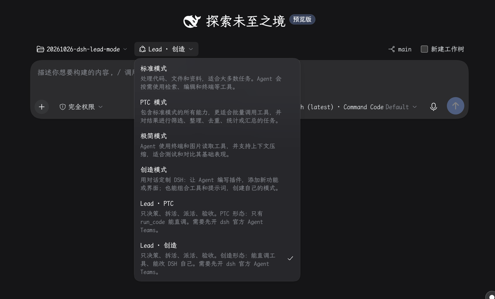
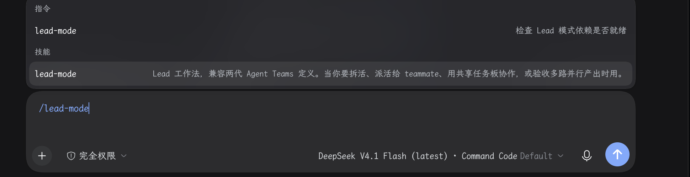

<div align="center">


# dsh-lead-mode

A Lead mode for DSH: the model judges, delegates, and reports the conclusion; members do the hands-on work, the checking, and the acceptance runs. The runtime ships the tools; this plugin ships the method.

[](https://www.npmjs.com/package/dsh-lead-mode)
[](https://github.com/xiebaiyuan/dsh-lead-mode/blob/main/package.json)
[](https://github.com/xiebaiyuan/dsh-lead-mode/blob/main/LICENSE)
[](https://github.com/xiebaiyuan/dsh-lead-mode/actions/workflows/ci.yml)
[](https://www.npmjs.com/package/dsh-lead-mode)
[](https://github.com/xiebaiyuan/dsh-lead-mode/actions/workflows/ci.yml)

`dsh plugin --profile <your profile> add dsh-lead-mode`

[中文](README.zh-CN.md) | English

</div>

## What this is

A Lead mode plugin for DSH (DeepSeek Harness). Version 0.2.9, requires host (the program running dsh) >= 0.2.2-rc.3, MIT licensed.

It covers the method layer. The official Agent Teams runtime hands you tools: the older generation has `spawn_teammate`, `send_message`, `team_task_*`; the newer one builds members with `subagent`, keeps `send_message` and `team_task_*`, and gets completion notices from the runtime instead of `wait_agent` polling. When to delegate, to whom, how to wait, how to review, how to merge several streams — none of that comes with the runtime.

Installing adds four things: two presets (`Lead · PTC`, `Lead · Create`), two skills (`lead-mode`, `team-digest`), one `/lead-mode` command, and two opening reminders. Not a single official preset is modified, and host behavior is untouched.

It does not replace the official Team mode. When Team is off it will not pretend it can delegate — it stops and hands you the next step.

## Why it is worth it

Agent Teams is off by default. Official Team tools are not in official presets; a session switch controls them, and on older hosts you also install a profile package. When those tools are missing there are two typical reactions: do everything serially in one context, or use `subagent` as a stand-in for a member. Both are wrong, and neither the user nor the model learns which piece was missing.

This plugin does three things:

1. Two presets that change only the persona. Every other field is copied line by line from the official `ptc` (24 lines) and `cordis` (23 lines), so no capability is lost.
2. Two skills that turn splitting work, delegating, running a shared task board, reviewing, and merging into a routine you can actually follow.
3. One self-check command and two reminders, so the model stops when Team is not ready and writes the next step as a command you can paste or a specific switch to flip.

The vision:

> Let your AI team pin down your requirements; the Lead oversees the full split and execution and gets 200% out of the model.

200% is the target, not a measured number.

Three invariants:

1. The method outlives the tools. Tools get renamed, hosts move on, the working method stays. Supporting two generations of Agent Teams is the first stress test of that claim.
2. Deliverables land in files. Progress logs, closing messages, and team summaries live on disk and still read fine a week later.
3. Missing pieces come with a next step. Never silence, never a workaround.

## Install

Two steps.

**One — install the plugin.**

```bash
dsh plugin --profile <your profile> add dsh-lead-mode
```

**Two — turn on the Team runtime.**

On newer hosts (0.2.2-rc.3 and up), enable "Agent team collaboration" in the Models & Reasoning Level menu; older hosts call that switch "Use agent team". The older-generation runtime has no such switch — install the official profile package instead, matching the version to what `dsh --version` prints:

```bash
dsh plugin --profile <your profile> add @deepseek-ai/dsh-experimental-agent-team-profile@0.2.2-rc.1
```

Restart dsh, then pick `Lead · PTC` or `Lead · Create` in the preset list of a new session and run `/lead-mode` to see the dependency status. If it returns success, you are set.

You can skip the presets entirely: any session accepts `/skill lead-mode` or `/skill team-digest`. What you lose is the short pointer in the persona; the method loads either way.

## Pick a preset

Lead changes method, not capability, so each preset mirrors an official one:

| Preset | Lines | Base | Difference |
|---|---|---|---|
| `lead-ptc` | 24 | official `ptc`, field by field | persona only |
| `lead-cordis` | 23 | official `cordis` (Create), field by field | persona, plus `skill-filesystem` without `customSkillDirs` |

**Pick `lead-ptc`** when the session writes programs, runs commands, and edits files in bulk. That is the PTC shape: only `run_code` takes direct calls, everything else is `tools.xxx()` inside a program. A Lead delegating, creating tasks, and sending messages follows that style.

**Pick `lead-cordis`** when tools are called directly, with `tool-cordis` available — sessions that modify DSH itself or call tools straight from the model. That is what "Create" means on this host.

`customSkillDirs` is omitted on purpose: the official expression resolves `@deepseek-ai/dsh-agent-preset` relative to the patch file, and this package cannot resolve the host package from there, so copying it line for line throws at load time. The cost is that the `dsh-doc` skill is not in `lead-cordis`'s filesystem skill directories.

Both presets are copied from the web-app presets, so they only fit desktop and Web profiles. Headless profiles lack those tool rows — do not switch a Lead preset on one.

## How it delegates


Four beats: a request arrives, the Lead splits and delegates, members work and report on a shared task board, and the fourth beat is acceptance. A member who did none of the work runs the checks, and the Lead decides from its evidence. The dashed line is the loop back when acceptance fails.

**Split.** The Lead does three things only: judge, delegate, and report the conclusion. What it touches is the control plane — `list_subagent_models` to pick models, `list_agents` for the roster, `team_task_*` for the board, `send_message` to nudge — and calling those is itself the delegating. It stays out of the working plane: code, files, logs, CI, packages all go to members, investigation and acceptance alike, and acceptance goes to a member who did none of the work. When this round has only the implementer, it spawns a separate read-only member to re-run, rather than doing it itself. If it cannot delegate, it stops and asks you to turn Team on — it does not finish the job alone and does not put `subagent` in a member's seat. Before delegating it picks provider/model pairs from what `list_subagent_models` returns, reasoning effort included. No invented ids. A single-entry list means the host authorized nothing else, so members inherit the Lead's route.

**Shared task board and progress logs.** Each member gets its own context. Whether to use a board is the Lead's call: build one when there are several members and they have to wait on each other or message each other; a job one member finishes in one round is delegated directly. With a board, the Lead creates tasks on `team_task_*` with goal and acceptance criteria spelled out; members claim them and work. Every member's first step is `.scratch/<effort>/worklog-<mate>.md` (`<effort>` names this round of work; `worklog-*.md` is the progress log), append-only, with the final round written before wrapping up. Write scopes (each member only touches its own files) are split by file or directory; when they overlap, task dependencies set the order. Who owns what, and who is stuck, is on the board — not in the chat log.

**Acceptance.** The Lead does not wait. It ends its turn after delegating; a member's completion notice starts the next round. Nudging goes through `send_message`, never `wait_agent` polling. This holds across both generations: older `send_message` takes `target`, newer takes `agent`. Reports must carry evidence: `path:line`, a command that can be pasted, a progress log section name, or `session-<id>#seq`. A finding only counts once an independent member has re-run it; the Lead reads that evidence before the final answer.

## What it looks like


The repo's social preview, 1280×630: icon on the left, title and a one-line positioning statement on the right.



The preset picker in a new session. The two entries are `Lead · PTC` and `Lead · Create`.



Typing `/lead-mode` in a session: the slash panel offers the command and the skill.

What it prints on a 0.2.7 install running on host 0.2.2-rc.5:

```text
Team 运行时：已挂载（新一代，teammate 走 subagent）
lead-ptc 预置：已注册
lead-cordis 预置：已注册

依赖齐了。切到 lead-ptc 或 lead-cordis 就能派活。
Team 开关是会话级的：模型与推理等级菜单里打开「开启智能体团队协作」（旧宿主叫「使用智能体团队」）。
```

## Skills and task tools

| Capability | Entry point | What you do |
|---|---|---|
| Lead presets | `Lead · PTC` or `Lead · Create` in the preset picker | Pick one |
| Lead method skill | `/skill lead-mode`, also self-loaded by the model | Nothing |
| Team summary skill | `/skill team-digest`, loaded at the model's discretion before wrapping up | Nothing |
| Dependency self-check | `/lead-mode` | Run it when dependencies look off |
| Two opening reminders | automatic | Nothing |

`lead-mode` covers: agreeing on the goal before starting; reading the tool list to tell which generation you are on; delegating with self-contained prompts; keeping write scopes disjoint (each member only touches its own files); the list/get/claim/complete flow on shared tasks; why not to wait on a member; where member models come from; the four-step handoff as context grows; and handing the final verification to an independent member.

`team-digest` merges the whole team's wrap-up into `reports/<YYYY-MM-DD>-<effort>.md` with six blocks: conclusion / who did what / acceptance evidence / deviations and unverified claims / what did not work and the decisions / open items and next steps. It is written only when this round of work had two or more members, or spanned two or more rounds.

Delegation uses three groups of tools: `subagent` / `subagent_fork` to create members, `send_message` to continue and nudge, and `team_task_create` / `team_task_get` / `team_task_list` / `team_task_update` for shared tasks. The older generation maps to `spawn_teammate` and `send_message({ target })` — same rules, different parameter names.

Both presets share one persona, 408 characters, injected into the system prompt every turn; details load from the skills on demand and cost no standing context.

Additive only, nothing modified. If a same-named skill or command already exists, the host takes first-come and this plugin steps aside.

## Compatibility and limits

| Item | Detail |
|---|---|
| Host | `>=0.2.2-rc.3` (`engines.dsh`), Node `>=20` |
| Agent Teams | Both generations supported; judged by the tool list, not by version number |
| Preset shape | Both presets are copied from the web-app presets and only fit desktop or Web profiles |
| Subagent models | The host's Subagent → Model selection is off by default; while off, explicit provider/model is rejected and members inherit the Lead's route. Changes apply to new sessions only |
| Interrupting members | Newer hosts ship `interrupt_agent` off (`interrupt: false`); ask the user to enable it before a hard interrupt |
| Host footprint | `cordis.patch.yml` is three `insert` rows in total: this plugin and its two presets. No tools registered, no agent lifecycle hooks, no request interception; uninstalling reclaims it all |
| Missing services | If `skills`, `commands`, or `agentTeams` is absent, the plugin still mounts, logs a warning, and drops that part of the toolset |
| Never opens Team for you | Installing the older profile package or flipping the newer session switch is always an explicit user action |

A field-by-field comparison of the two generations is in [docs/agent-teams.md](https://github.com/xiebaiyuan/dsh-lead-mode/blob/main/docs/agent-teams.md); what goes wrong when versions are mismatched is in [docs/why.md](https://github.com/xiebaiyuan/dsh-lead-mode/blob/main/docs/why.md).

## Docs

| Looking for | Where |
|---|---|
| Motivation, problem breakdown, boundaries | [docs/why.md](https://github.com/xiebaiyuan/dsh-lead-mode/blob/main/docs/why.md) |
| Install, enabling Team, usage, capability detail, dependency table | [docs/usage.md](https://github.com/xiebaiyuan/dsh-lead-mode/blob/main/docs/usage.md) |
| Two generations of Agent Teams, side by side | [docs/agent-teams.md](https://github.com/xiebaiyuan/dsh-lead-mode/blob/main/docs/agent-teams.md) |
| Design tradeoffs: staying out of the official way, preset differences | [docs/design.md](https://github.com/xiebaiyuan/dsh-lead-mode/blob/main/docs/design.md) |
| Layout, development, tests, releases | [docs/development.md](https://github.com/xiebaiyuan/dsh-lead-mode/blob/main/docs/development.md) |
| The Lead method itself | [skills/lead-mode/SKILL.md](https://github.com/xiebaiyuan/dsh-lead-mode/blob/main/skills/lead-mode/SKILL.md) |
| Team summary rules | [skills/team-digest/SKILL.md](https://github.com/xiebaiyuan/dsh-lead-mode/blob/main/skills/team-digest/SKILL.md) |
| Vocabulary | [GLOSSARY.md](https://github.com/xiebaiyuan/dsh-lead-mode/blob/main/GLOSSARY.md) |
| Change history | [CHANGELOG.md](https://github.com/xiebaiyuan/dsh-lead-mode/blob/main/CHANGELOG.md) |
| Sample team summaries | [reports/](https://github.com/xiebaiyuan/dsh-lead-mode/tree/main/reports) |

`docs/` is not shipped in the npm package, so those pages exist on GitHub only; every link is absolute, which also keeps them clickable from the npm page.

## Friendly link: dsh-context

This plugin only covers Lead mode. Visualizing the whole team's state and traffic is [dsh-context](https://github.com/bowenliang123/dsh-context)'s job — a separate project.

| Item | Value |
|---|---|
| Repo | https://github.com/bowenliang123/dsh-context |
| Author | bowenliang123 |
| License | Apache-2.0 |
| Install | `dsh plugin --profile <your profile> add dsh-context` |

It does not install with this plugin and is not a dependency of it. The fleet page exists only when it is installed.

Once installed, every session gains a Fleet tab (to the right of Context), and the Context panel in the right rail shows the same card with five sections:

| Section | What you see |
|---|---|
| Overview | Member status, live context, estimated spend, task progress |
| Agent Network | The current agent, its parent, and all subagents — one card each |
| Fleet Members | Each member's role, model, latest reply, runtime, step count, open task count |
| Tasks | Team tasks and subagent delegations together, grouped by owner, with blocked-by chains |
| Agent Comms | Who said what to whom: team messages, mailbox deliveries, runtime settlement notices |

## License

MIT. Full text in [LICENSE](https://github.com/xiebaiyuan/dsh-lead-mode/blob/main/LICENSE).
