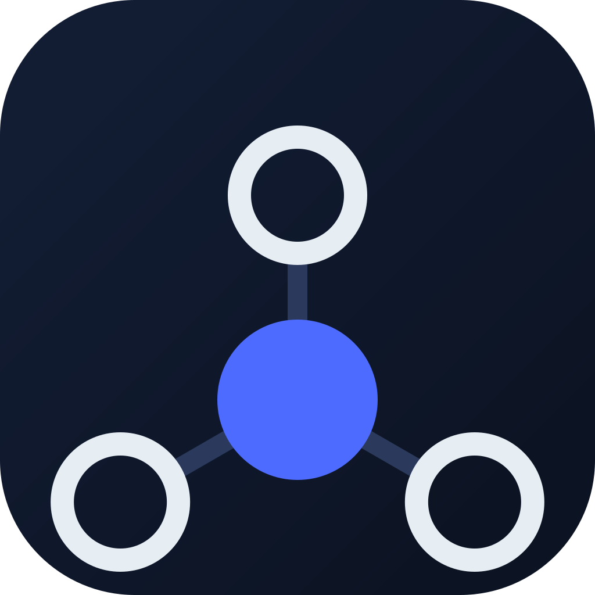
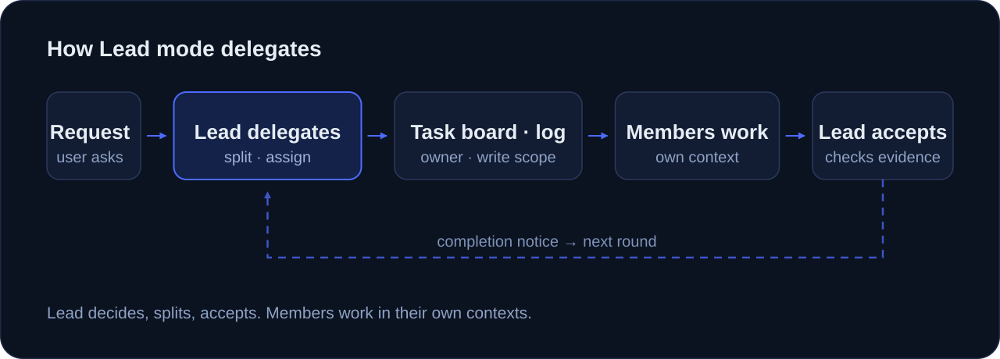

<div align="center">



# dsh-lead-mode

A Lead workflow plugin for DeepSeek Harness (DSH): the Lead model plans, delegates, and reports conclusions, while members explore, build, and run independent verification. DSH provides the tools; this plugin supplies the method.

[](https://www.npmjs.com/package/dsh-lead-mode)
[](https://github.com/xiebaiyuan/dsh-lead-mode/blob/main/package.json)
[](https://github.com/xiebaiyuan/dsh-lead-mode/blob/main/LICENSE)
[](https://github.com/xiebaiyuan/dsh-lead-mode/actions/workflows/ci.yml)
[](https://www.npmjs.com/package/dsh-lead-mode)
[](https://github.com/xiebaiyuan/dsh-lead-mode/actions/workflows/ci.yml)

`dsh plugin --profile <your profile> add dsh-lead-mode`

[中文](README.zh-CN.md) | English

</div>

## What it is

A Lead workflow plugin for DSH (DeepSeek Harness). Current release: `0.2.16`, targeting hosts `>= 0.2.2-rc.3`, MIT licensed.

The official Agent Teams runtime gives the model delegation primitives (`spawn_teammate`, `send_message`, `team_task_*` on older hosts; `subagent`, `send_message`, `team_task_*`, and automatic settlement notices on newer hosts). What the runtime leaves unspecified is the operating discipline: when to split work, who owns which files, how to wait without polling, how to verify output independently, and when to stop or escalate.

This plugin adds that method layer through two presets (`Lead · PTC` and `Lead · Create`), two runtime skills (`lead-mode` and `team-digest`), one diagnostic command (`/lead-mode`), and two opening reminders. Official presets stay untouched, and host behavior is unchanged.

It complements official Team mode rather than replacing it. When Team tools are absent, the Lead stops and hands you the exact command or menu switch to enable them.

## Why use it

Official Agent Teams is off by default. A session switch controls it on newer hosts, and older hosts require an extra profile package. When those tools are missing, sessions usually fall into one of two failure modes: the model does everything serially in one context, or calls plain `subagent` in place of teammates. Neither gives the user a clear signal about what was missing.

This plugin closes three gaps:

1. **Two capability-preserving presets**: Each preset copies every plugin row from its official counterpart (`ptc` with 24 plugin rows, `cordis` with 23 plugin rows) and changes only the persona prefix.
2. **Executable team routines**: Two runtime skills standardize task triage, disjoint write scopes, shared task boards, independent acceptance, long-horizon stop-loss, and final team digests.
3. **Clear startup diagnostics**: One `/lead-mode` command and two opening reminders check runtime readiness and print the exact switch or install command when Team is disabled.

Vision:

> Let your AI team pin down your requirements; the Lead oversees the full split and execution and gets 200% out of the model.

`200%` is an aspirational target, not a benchmark measurement.

Three invariants guide every change in this repository:

1. **The method outlives tool renames.** Supporting both Agent Teams generations without changing the Lead persona tests this rule directly.
2. **Deliverables stay on disk.** Progress logs, handoff notes, and team digests live in files you can inspect days later.
3. **Missing prerequisites surface concrete next steps.** Never fail silently, and never improvise a workaround.

## Quick start

1. **Install the plugin.**

```bash
dsh plugin --profile <your profile> add dsh-lead-mode
```

2. **Enable the official Team runtime.**
   - **Newer hosts (`>= 0.2.2-rc.3`)**: Open the **Models & Reasoning Level** menu in your session and enable **Agent team collaboration** (labeled **Use agent team** on earlier previews).
   - **Older hosts (`<= 0.2.2-rc.1`)**: Install the official profile package, matching the version pin to `dsh --version`:

```bash
dsh plugin --profile <your profile> add @deepseek-ai/dsh-experimental-agent-team-profile@0.2.2-rc.1
```

Restart DSH, pick **Lead · PTC** or **Lead · Create** (`Lead · 创造`) in a new session, and run `/lead-mode`. Once it reports success, you are ready to delegate.

You can also use the skills directly in any preset by running `/skill lead-mode` or `/skill team-digest`. You only skip the persona pointer in the system prompt; the workflow rules load the same way.

## Choose a preset

Lead mode changes workflow discipline, not tool capabilities, so each preset mirrors an official baseline:

| Preset | Plugin rows | Official baseline | Difference |
|---|---|---|---|
| `lead-ptc` | 24 | `ptc` (field by field) | Persona only |
| `lead-cordis` | 23 | `cordis` / Create (field by field) | Persona, plus `skill-filesystem` without `customSkillDirs` |

- **Pick `lead-ptc`** for coding, bulk file edits, shell pipelines, and data processing. Under PTC, only `run_code` accepts direct calls while every other tool runs inside TypeScript via `tools.xxx()`.
- **Pick `lead-cordis`** when you want direct tool calls with `tool-cordis` enabled, such as modifying DSH itself or creating plugins.

`lead-cordis` omits `customSkillDirs` on purpose because the upstream `!!js` expression resolves `@deepseek-ai/dsh-agent-preset` relative to `cordis.patch.yml`'s location, which throws when loaded from an external plugin package. As a result, `dsh-doc` is not mounted in `lead-cordis`'s filesystem skill list.

Both presets mirror the web-app preset structure and target desktop or Web profiles only. Headless profiles lack those UI/tool rows and should not use Lead presets.

## How delegation works



Delegation separates the **control plane** (Lead) from the **work plane** (members) across four stages:

### 1. Control plane vs. work plane

The Lead handles only decisions, task splitting, delegation, and final reporting. It interacts exclusively with control-plane tools (`list_subagent_models`, `list_agents`, `team_task_*`, `send_message`) and leaves code reading, edits, test runs, log checks, CI verification, and packaging to members.

- Before spawning members, the Lead calls `list_subagent_models` and picks valid `provider/model` pairs (and reasoning effort when authorized), never inventing model IDs. When the list has a single entry, members inherit the Lead's route.
- If Team tools are unavailable, the Lead halts and asks you to enable Team instead of working solo or substituting plain `subagent` for teammates.

### 2. Shared task board, worklogs & priority guardrails

- **Priority triage (`§12`)**: Requests are tagged as **primary** (`#1..#M` must-have criteria), **supporting** (blocking prerequisites with an explicit stop line), or **side** items. Side items stay out of the parallel queue and go straight into `.scratch/<effort>/leftovers.md`.
- **Disjoint write scopes & task boards**: Non-overlapping tasks launch together in parallel; dependent tasks chain via `blocked_by`. Each member starts by creating `.scratch/<effort>/worklog-<mate>.md` (append-only round log) so progress survives context compaction.

### 3. Event-driven acceptance

The Lead never polls with `wait_agent`. After delegating, it ends its turn and resumes when the runtime delivers a member's completion notice (`Its closing message:`) or `send_message` nudge—consistent across both Agent Teams generations (`target` on older hosts, `agent` on newer hosts).

Every reported conclusion requires verifiable evidence (`path:line`, a pasteable command, a worklog section, or `session-<id>#seq`). Final verification must be run by an independent member who did none of the implementation; if only the implementer ran in this round, the Lead spawns a separate read-only verifier rather than running checks itself.

## In action


*Preset picker in a new DSH session showing **Lead · PTC** and **Lead · 创造** (`Lead · Create`).*


*Typing `/lead-mode` surfaces both the diagnostic command and the `lead-mode` skill.*

Sample `/lead-mode` output captured on host `0.2.2-rc.5`:

```text
Team 运行时：已挂载（新一代，teammate 走 subagent）
lead-ptc 预置：已注册
lead-cordis 预置：已注册

依赖齐了。切到 lead-ptc 或 lead-cordis 就能派活。
Team 开关是会话级的：模型与推理等级菜单里打开「开启智能体团队协作」（旧宿主叫「使用智能体团队」）。
```

## Skills & task tools

| Capability | Entry point | User action |
|---|---|---|
| Lead presets | `Lead · PTC` or `Lead · Create` (`Lead · 创造`) in preset picker | Select one for the session |
| Lead method skill | `/skill lead-mode` (also model-invocable) | Automatic or invoke on demand |
| Team summary skill | `/skill team-digest` (invoked before wrap-up) | Automatic on multi-member/multi-round work |
| Dependency check | `/lead-mode` | Run whenever Team readiness looks unclear |
| Opening reminders | Built into persona and startup warnings | Automatic |

### `lead-mode` skill & on-demand references

The core skill ([skills/lead-mode/SKILL.md](https://github.com/xiebaiyuan/dsh-lead-mode/blob/main/skills/lead-mode/SKILL.md)) defines goal alignment, runtime generation detection, self-contained delegation prompts, disjoint write scopes, `team_task_*` lifecycle, event-driven waiting, 4-step context handoff, strict acceptance with a 2-retry rework cap (swap member, narrow scope without lowering criteria, or ask the user), independent final verification, and a rare last-resort escalation to one plan-only specialist on the Lead's model.

Five reference guides under `skills/lead-mode/references/` load only when relevant:

| Reference | Loaded when | Focus |
|---|---|---|
| `ptc-calls.md` | Running inside `lead-ptc` | Calling `tools.xxx()` inside `run_code` and `Promise.all` reads |
| `old-gen.md` | Host has `spawn_teammate` | Legacy `spawn_teammate` parameters, states, and limits |
| `member-models.md` | Selecting per-member models | `list_subagent_models` routing and stall escalation link |
| `tool-signatures.md` | Writing delegation calls | Side-by-side parameter diffs across both generations |
| `long-horizon.md` | Multi-round or cross-module work (`>= 2` rounds) | `N/M` criteria ledger, tiered verification (default max 2 full runs), stronger-model `fresh` escalation after 2 stagnant rounds, and 3-step post-compaction re-anchoring |

### `team-digest` & shared persona

- **`team-digest`** ([skills/team-digest/SKILL.md](https://github.com/xiebaiyuan/dsh-lead-mode/blob/main/skills/team-digest/SKILL.md)) consolidates worklogs and closing messages into `reports/<YYYY-MM-DD>-<effort>.md` whenever work involves `>= 2` members or `>= 2` rounds. It enforces six sections starting with `主目标：达成/部分达成/未达成（N/M）`.
- **Delegation tool groups**: `subagent` / `subagent_fork` (`spawn_teammate` on older hosts) to spawn members, `send_message` to nudge or continue, and `team_task_create` / `team_task_get` / `team_task_list` / `team_task_update` for shared task tracking.
- **Zero standing bloat**: Both presets share an identical 468-character persona prefix anchoring priority protection and long-horizon stop-loss; detailed rules load on demand. If a skill or command name collides, the host's existing registration wins and this plugin yields.

## Compatibility & limits

| Item | Behavior & limit |
|---|---|
| Host & runtime | Requires `dsh >= 0.2.2-rc.3` (`engines.dsh`) and Node.js `>= 20` |
| Agent Teams | Supports both generations; detected from available tools rather than version string |
| Profile scope | Presets mirror web-app presets and apply only to desktop or Web profiles |
| Subagent models | Host **Subagent → Model selection** is off by default; while off, explicit `provider/model` fails and members inherit the Lead's route (setting changes apply to new sessions only) |
| Interrupting members | Newer hosts default `interrupt_agent` to off (`interrupt: false`); ask the user to enable it before issuing hard interrupts |
| Host footprint | `cordis.patch.yml` has only 3 `insert` entries (plugin + 2 presets); registers zero tools, lifecycle hooks, or request interceptors |
| Graceful degradation | If `skills`, `commands`, or `agentTeams` is missing, the plugin still mounts, logs a warning, and skips only that surface |
| Explicit Team opt-in | Enabling the session switch or installing the legacy profile package is always an explicit user action |

See [docs/en/agent-teams.md](https://github.com/xiebaiyuan/dsh-lead-mode/blob/main/docs/en/agent-teams.md) for a field-by-field runtime comparison and [docs/en/why.md](https://github.com/xiebaiyuan/dsh-lead-mode/blob/main/docs/en/why.md) for version-mismatch diagnostics.

## Documentation

| Topic | English | 中文 |
|---|---|---|
| Motivation, problem breakdown, boundaries | [docs/en/why.md](https://github.com/xiebaiyuan/dsh-lead-mode/blob/main/docs/en/why.md) | [docs/why.md](https://github.com/xiebaiyuan/dsh-lead-mode/blob/main/docs/why.md) |
| Installation, enabling Team, usage, peer dependencies | [docs/en/usage.md](https://github.com/xiebaiyuan/dsh-lead-mode/blob/main/docs/en/usage.md) | [docs/usage.md](https://github.com/xiebaiyuan/dsh-lead-mode/blob/main/docs/usage.md) |
| Two generations of Agent Teams & parallel rules | [docs/en/agent-teams.md](https://github.com/xiebaiyuan/dsh-lead-mode/blob/main/docs/en/agent-teams.md) | [docs/agent-teams.md](https://github.com/xiebaiyuan/dsh-lead-mode/blob/main/docs/agent-teams.md) |
| Design tradeoffs & preset diffs | [docs/en/design.md](https://github.com/xiebaiyuan/dsh-lead-mode/blob/main/docs/en/design.md) | [docs/design.md](https://github.com/xiebaiyuan/dsh-lead-mode/blob/main/docs/design.md) |
| Repository layout, testing & release flow | [docs/en/development.md](https://github.com/xiebaiyuan/dsh-lead-mode/blob/main/docs/en/development.md) | [docs/development.md](https://github.com/xiebaiyuan/dsh-lead-mode/blob/main/docs/development.md) |
| Lead method skill | [skills/lead-mode/SKILL.md](https://github.com/xiebaiyuan/dsh-lead-mode/blob/main/skills/lead-mode/SKILL.md) | — |
| Team digest skill | [skills/team-digest/SKILL.md](https://github.com/xiebaiyuan/dsh-lead-mode/blob/main/skills/team-digest/SKILL.md) | — |
| Glossary, changelog & sample reports | [CHANGELOG.md](https://github.com/xiebaiyuan/dsh-lead-mode/blob/main/CHANGELOG.md) · [reports/](https://github.com/xiebaiyuan/dsh-lead-mode/tree/main/reports) | [GLOSSARY.md](https://github.com/xiebaiyuan/dsh-lead-mode/blob/main/GLOSSARY.md) |

`docs/` is excluded from the published npm tarball, so all links above point directly to GitHub and work from both GitHub and npmjs.com.

## Friendly link: dsh-context

This plugin covers only Lead workflow discipline. Visualizing fleet-wide state, spend, and inter-agent messages is handled by [dsh-context](https://github.com/bowenliang123/dsh-context), an independent project.

| Item | Value |
|---|---|
| Repo | https://github.com/bowenliang123/dsh-context |
| Author | bowenliang123 |
| License | Apache-2.0 |
| Install | `dsh plugin --profile <your profile> add dsh-context` |

`dsh-context` is not bundled with or required by `dsh-lead-mode`. The Fleet UI appears only when you install it separately, adding a **Fleet** tab next to **Context** with five sections:

| Section | What you see |
|---|---|
| Overview | Member status, live context usage, estimated spend, task progress |
| Agent Network | Current agent, its parent, and all child members as individual cards |
| Fleet Members | Role, model, latest reply, runtime duration, step count, open task count |
| Tasks | Team tasks and member delegations grouped by owner with `blocked_by` chains |
| Agent Comms | Team messages, mailbox deliveries, and runtime settlement notices |

## Friendly link: LINUX DO

- [LINUX DO](https://linux.do/) — Developer and tech community.

## License

MIT. Full text in [LICENSE](https://github.com/xiebaiyuan/dsh-lead-mode/blob/main/LICENSE).
