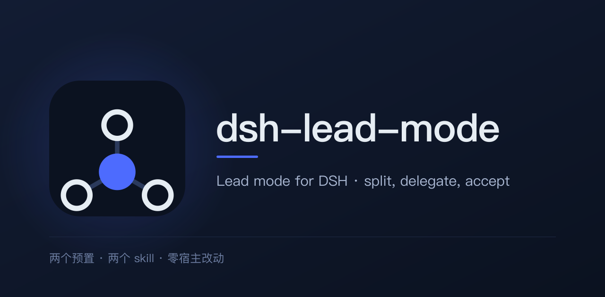

<div align="center">


# dsh-lead-mode

给 DSH 加 Lead 模式：模型只做判断、派活、讲结论，写代码、查证、验收都交给成员。工具官方给，方法这里补。

[](https://www.npmjs.com/package/dsh-lead-mode)
[](https://github.com/xiebaiyuan/dsh-lead-mode/blob/main/package.json)
[](https://github.com/xiebaiyuan/dsh-lead-mode/blob/main/LICENSE)
[](https://github.com/xiebaiyuan/dsh-lead-mode/actions/workflows/ci.yml)
[](https://www.npmjs.com/package/dsh-lead-mode)
[](https://github.com/xiebaiyuan/dsh-lead-mode/actions/workflows/ci.yml)

`dsh plugin --profile <你的 profile 名> add dsh-lead-mode`

中文 | [English](README.md)

</div>

## 这是什么

DSH（DeepSeek Harness）的 Lead 模式插件。当前版本 0.2.9，对宿主（跑 dsh 的那个程序）的要求是 >= 0.2.2-rc.3，MIT 许可。

它补的是方法层。官方的 Agent Teams 运行时给工具：老一代是 `spawn_teammate`、`send_message`、`team_task_*`；新一代用 `subagent` 建成员，`send_message` 与 `team_task_*` 还在；成员收工由运行时通知，不需要 `wait_agent` 轮询。什么时候派活、派给谁、怎么等结果、怎么验收、多路产出怎么合并，运行时不管。

装完多出四样东西：两个预置（「Lead · PTC」「Lead · 创造」）、两个 skill（`lead-mode`、`team-digest`）、一条 `/lead-mode` 命令、两条开场提示。官方预置一个字没改，宿主行为也没改。

不替代官方 Team 模式。没开 Team 时它不会假装能派活，而是停手，把下一步交给你。

## 为什么值得用

官方的 Agent Teams 默认不开。官方预置里没有 Team 工具，它由会话开关单独控制；老一代宿主还要先装一个 profile 包。工具不齐时，模型常见两种反应：自己串行干完，或者拿 `subagent` 顶替成员。两种都不对，而且用户和模型都不知道缺了哪一步。

本插件做三件事：

1. 两个预置，只换 persona。其余字段逐行照抄官方 `ptc`（24 行）与 `cordis`（23 行），能用的工具一点不少。
2. 两个 skill，把拆活、派活、共享任务板、验收、收尾合并成一套可执行的规矩。
3. 一条自检命令加两条提醒，Team 不齐时让模型停手，下一步写成可粘贴的命令或具体开关。

愿景：

> 让你的 AI 团队明确你的需求，Lead 监督完整的拆解与执行过程，把模型的能力发挥到 200%。

200% 是目标，不是实测数字。

三条不变量：

1. 方法比工具活得久。工具换名、宿主换代，工作法不变。两代 Agent Teams 兼容是这条的第一次压力测试。
2. 交付物落在文件里。工作日志、收尾消息、团队汇总都在磁盘上，过一周还能回看。
3. 缺东西就给下一步。不沉默，也不硬撑。

## 装

两步。

**一、装插件。**

```bash
dsh plugin --profile <你的 profile 名> add dsh-lead-mode
```

**二、开 Team 运行时。**

新一代宿主（0.2.2-rc.3 起）打开「模型与推理等级」菜单里的「开启智能体团队协作」，旧宿主这个开关叫「使用智能体团队」。老一代宿主没有这个开关，装官方 profile 包，版本号按 `dsh --version` 的输出换：

```bash
dsh plugin --profile <你的 profile 名> add @deepseek-ai/dsh-experimental-agent-team-profile@0.2.2-rc.1
```

重启 dsh，在新会话的预置列表里挑「Lead · PTC」或「Lead · 创造」，敲 `/lead-mode` 看依赖状态。返回 success 就齐了。

不换预置也能用：任何会话敲 `/skill lead-mode` 或 `/skill team-digest`。少掉的是 persona 里那句短指针，方法本身照常加载。

## 两个预置怎么选

Lead 只换方法、不换能力，所以两个预置各镜像一个官方预置：

| 预置 | 行数 | 基线 | 差异 |
|---|---|---|---|
| `lead-ptc` | 24 | 官方 `ptc` 逐字段 | 只换 persona |
| `lead-cordis` | 23 | 官方 `cordis`（创造）逐字段 | persona，外加 `skill-filesystem` 不带 `customSkillDirs` |

**选 `lead-ptc`**：会话要写程序、跑命令、批量改文件。这是 PTC 形态，只有 `run_code` 能直调，其余工具在程序里用 `tools.xxx()` 调。Lead 的派活、建任务、发消息都按这个写法走。

**选 `lead-cordis`**：工具能直调，带 `tool-cordis`，适合要改 DSH 自己或要直接调工具的会话。这台宿主上「创造」就是这个意思。

`customSkillDirs` 是故意不带的：官方那条表达式按 patch 文件自己的位置解析 `@deepseek-ai/dsh-agent-preset`，本包从那里解析不到宿主包，照抄会在加载时抛错。代价是 `dsh-doc` skill 不在 `lead-cordis` 的文件系统 skill 目录里。

两个预置都按 web-app 的预置抄，只适合桌面端或 Web profile。headless profile 没有这些工具行，别在那边切 Lead 预置。

## 它怎么派活


四拍：需求进来，Lead 拆活派活，成员在共享任务板上动手并回报，第四拍是验收：派没参与实现的成员跑，Lead 拿回证据判断能不能收尾。虚线是验收不通过时的回路。

**拆活。** Lead 只做三件事：判断、派活、把结论讲给用户。它碰的是控制面：`list_subagent_models` 挑模型、`list_agents` 看名册、`team_task_*` 管任务板、`send_message` 催人，这些自己调，那本身就是派活。业务面不碰：代码、文件、日志、CI、包都交给成员，调查与验收都派，验收要派没参与实现的那位；本轮只有实现者本人时，另派一个只读成员复跑，不退回自己跑。派不下去就停手，让你去开 Team，不自己干完，也不拿 `subagent` 顶替成员。派活前先调 `list_subagent_models`，从返回的清单里成对挑 provider/model，可以带推理档，不许编造 id。清单只有一条，说明宿主没授权别的模型，成员一律继承 Lead 的路由。

**共享任务板与工作日志。** 成员各有自己的上下文。建不建任务板由 Lead 判：多成员、要交叉等待或互相发消息才建，一个人一轮能干完的直接派。建了板，Lead 在 `team_task_*` 上建单、写清目标与验收标准，成员领单后动手；每个成员第一步建 `.scratch/<effort>/worklog-<mate>.md`（`<effort>` 是这轮活的名字，`worklog-*.md` 是工作日志），只追加轮次记录，收尾前补完最后一轮。写作用域（各成员只改自己那摊文件）按文件或目录分开，重叠时用任务依赖排顺序。谁领了哪张单、卡在谁身上，看板子，不看聊天记录。

**验收。** Lead 不等。派完活结束回合，成员收工的通知会起下一轮；催人用 `send_message`，不调 `wait_agent` 轮询。两代 Agent Teams 都按这个规矩：老一代 `send_message` 的参数叫 `target`，新一代叫 `agent`。成员回报要带来源标记：`路径:行号`、能粘贴的命令、工作日志段名，或 `session-<id>#seq`。关键结论要让独立成员跑过才算数，Lead 看完证据再给最终答复。

## 看到的样子



仓库的社交预览图，1280×630。左边图标，右边标题与一行定位语。


新会话的预置下拉。两个入口分别是「Lead · PTC」与「Lead · 创造」。


在会话里输入 `/lead-mode`，斜杠面板给出「指令」与「技能」两条入口。

敲下去报的是这些（0.2.7 装在 0.2.2-rc.5 宿主上的实际输出）：

```text
Team 运行时：已挂载（新一代，teammate 走 subagent）
lead-ptc 预置：已注册
lead-cordis 预置：已注册

依赖齐了。切到 lead-ptc 或 lead-cordis 就能派活。
Team 开关是会话级的：模型与推理等级菜单里打开「开启智能体团队协作」（旧宿主叫「使用智能体团队」）。
```

## 技能与任务工具

| 能力 | 入口 | 你要做什么 |
|---|---|---|
| Lead 预置 | 预置下拉里的「Lead · PTC」或「Lead · 创造」 | 挑一个切过去 |
| Lead 工作法 skill | `/skill lead-mode`，模型也会自己加载 | 不用管 |
| 团队汇总 skill | `/skill team-digest`，模型收尾前自己判断写不写 | 不用管 |
| 依赖自检 | `/lead-mode` | 依赖不对时敲一下 |
| 两层开场提示 | 自动 | 不用管 |

`lead-mode` skill 覆盖这些：开工前对齐目标；按工具清单判代际；派活自包含；写作用域不重叠；共享任务的 list/get/claim/complete 流程；为什么不等成员；成员模型从哪来；上下文变长后的交接四步；最终验证派独立成员做。

`team-digest` 把全队收尾合成一份 `reports/<YYYY-MM-DD>-<effort>.md`，六块骨架：结论 / 谁干了什么 / 验收证据 / 偏离与未验证 / 死路与决策 / 未决与下一步。这轮活有 2 个以上成员，或跨 2 轮以上，才写。

派活用到三组工具：`subagent` / `subagent_fork` 建成员，`send_message` 续聊与催办，`team_task_create` / `team_task_get` / `team_task_list` / `team_task_update` 管共享任务。老一代对应 `spawn_teammate` 与 `send_message({ target })`，规矩一样，参数名不同。

两个预置的 persona 逐字相同，408 字，每轮都进 system prompt；细节按需从 skill 加载，不占常驻上下文。

只新增，不修改。同名 skill 或命令撞了，宿主先到先得，本插件让位。

## 兼容与限制

| 项 | 说明 |
|---|---|
| 宿主 | `>=0.2.2-rc.3`（`engines.dsh`），Node `>=20` |
| Agent Teams | 两代都支持，按工具清单判代际，不看版本号 |
| 预置形态 | 两个预置都按 web-app 预置抄，只适合桌面端或 Web profile |
| 子智能体模型 | 宿主「子智能体 → 模型选择」默认关闭；关着时显式 provider/model 会被拒，成员继承 Lead 的路由。改完设置只有新会话生效 |
| 打断成员 | 新宿主 `interrupt_agent` 默认关闭（`interrupt: false`）；要硬打断，先让用户打开 |
| 不碰宿主 | `cordis.patch.yml` 全文三行 `insert`：本插件加两个预置。不注册工具、不监听 agent 生命周期、不拦截请求；卸载即回收 |
| 缺服务 | `skills` / `commands` / `agentTeams` 任一缺失时插件照常挂载，只打 warn，丢掉对应的那部分工具 |
| 不代开 Team | 老一代装 profile 包、新一代开会话开关，都是用户显式动作 |

老一代与新一代码差异的逐项对照在 [docs/agent-teams.md](https://github.com/xiebaiyuan/dsh-lead-mode/blob/main/docs/agent-teams.md)，装错版本的后果在 [docs/why.md](https://github.com/xiebaiyuan/dsh-lead-mode/blob/main/docs/why.md)。

## 文档索引

| 想看什么 | 去哪 |
|---|---|
| 为什么需要、问题拆解、边界 | [docs/why.md](https://github.com/xiebaiyuan/dsh-lead-mode/blob/main/docs/why.md) |
| 安装、开启 Team、用法、能力细说、依赖表 | [docs/usage.md](https://github.com/xiebaiyuan/dsh-lead-mode/blob/main/docs/usage.md) |
| 两代 Agent Teams 对照与判定 | [docs/agent-teams.md](https://github.com/xiebaiyuan/dsh-lead-mode/blob/main/docs/agent-teams.md) |
| 设计取舍：不干扰官方、预置差异 | [docs/design.md](https://github.com/xiebaiyuan/dsh-lead-mode/blob/main/docs/design.md) |
| 目录、开发、测试、发版 | [docs/development.md](https://github.com/xiebaiyuan/dsh-lead-mode/blob/main/docs/development.md) |
| Lead 工作法原文 | [skills/lead-mode/SKILL.md](https://github.com/xiebaiyuan/dsh-lead-mode/blob/main/skills/lead-mode/SKILL.md) |
| 团队汇总规则 | [skills/team-digest/SKILL.md](https://github.com/xiebaiyuan/dsh-lead-mode/blob/main/skills/team-digest/SKILL.md) |
| 术语 | [GLOSSARY.md](https://github.com/xiebaiyuan/dsh-lead-mode/blob/main/GLOSSARY.md) |
| 版本记录 | [CHANGELOG.md](https://github.com/xiebaiyuan/dsh-lead-mode/blob/main/CHANGELOG.md) |
| 团队汇总样例 | [reports/](https://github.com/xiebaiyuan/dsh-lead-mode/tree/main/reports) |

`docs/` 不进 npm 包，这几篇只在 GitHub 上有；链接都写成绝对地址，在 npm 页面上也能点开。

## 友链：dsh-context

本插件只做 Lead 模式。整队状态与通信的可视化是 [dsh-context](https://github.com/bowenliang123/dsh-context) 的活，那是另一个项目。

| 项 | 值 |
|---|---|
| 仓库 | https://github.com/bowenliang123/dsh-context |
| 作者 | bowenliang123 |
| 许可 | Apache-2.0 |
| 装法 | `dsh plugin --profile <你的 profile 名> add dsh-context` |

它不随本插件安装，也不是本插件的依赖。只有装了它，编队页才存在。

装好后每个会话多一个「编队 / Fleet」标签页（在 Context 右边），右栏的 Context 面板里有同一张卡，五个区块：

| 区块 | 看什么 |
|---|---|
| 概要 | 成员状态、实时上下文、预估花费、任务进度 |
| Agent Network | 当前 agent、它的父级、全部子代理，一人一张卡 |
| Fleet Members | 每个成员的角色、模型、最新回复、运行时长、步数、在办任务数 |
| Tasks | 团队任务与子代理派活放一起，按 owner 分组，带 blocked-by 链 |
| Agent Comms | 谁跟谁说了什么：团队消息、邮箱投递、运行时的结算通知 |

## 许可

MIT。全文见 [LICENSE](https://github.com/xiebaiyuan/dsh-lead-mode/blob/main/LICENSE)。
