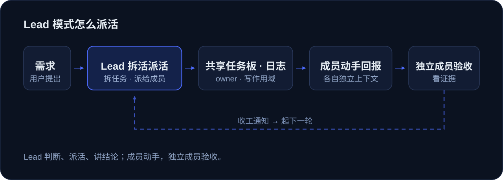
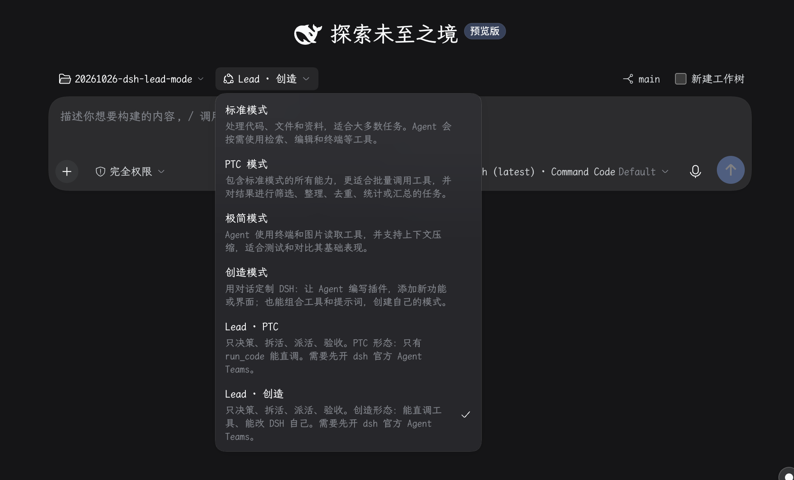
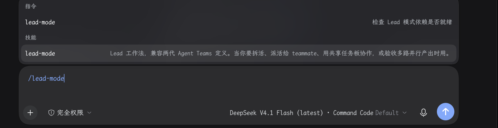

<div align="center">


# dsh-lead-mode

给 DeepSeek Harness（DSH）加上 Lead 工作法：模型只做判断、拆活、派活与讲结论，查证、写代码与独立验收交给成员。工具官方给，方法这里补。

[](https://www.npmjs.com/package/dsh-lead-mode)
[](https://github.com/xiebaiyuan/dsh-lead-mode/blob/main/package.json)
[](https://github.com/xiebaiyuan/dsh-lead-mode/blob/main/LICENSE)
[](https://github.com/xiebaiyuan/dsh-lead-mode/actions/workflows/ci.yml)
[](https://www.npmjs.com/package/dsh-lead-mode)
[](https://github.com/xiebaiyuan/dsh-lead-mode/actions/workflows/ci.yml)

`dsh plugin --profile <你的 profile 名> add dsh-lead-mode`

中文 | [English](README.md)

</div>

## 这是什么

DSH（DeepSeek Harness）的 Lead 工作法插件。当前版本 `0.2.22`，要求宿主 `>= 0.2.2-rc.3`，MIT 许可。

官方 Agent Teams 运行时只提供派活原语：老一代有 `spawn_teammate`、`send_message`、`team_task_*`；新一代用 `subagent` 建成员，保留 `send_message` 与 `team_task_*`，并由运行时自动投递收工通知，不需要 `wait_agent` 轮询。至于什么时候拆活、文件怎么隔离、怎么等齐、怎么独立验收、卡住何时止损，运行时不管。

装上本插件后多出四样东西：两个预置（「Lead · PTC」「Lead · 创造」）、两个运行时 skill（`lead-mode`、`team-digest`）、一条 `/lead-mode` 自检命令和两层开场提示。官方预置一字不改，宿主行为也保持原样。

它和官方 Team 模式配合工作，不替代 Team 运行时。没开 Team 时，模型会停手并给出下一步操作，不会硬撑着自己干完。

## 为什么值得用

官方 Agent Teams 默认关闭。新一代宿主靠会话开关控制，老一代还要另装 profile 包。Team 工具没挂载时，会话常踩进两个坑：模型自己在单个上下文里串行干完，或者拿普通 `subagent` 顶替团队成员。两种都不对，用户也看不出究竟缺了哪一步。

本插件做三件事：

1. **两个不减能力的预置**：除 persona 外，其余插件行逐行镜像官方 `ptc`（24 行）和 `cordis`（23 行），工具集一点不少。
2. **可执行的团队工作法**：两个 skill 把主目标判级、写作用域隔离、共享任务板、独立验收、长程止损和团队汇总写进固定流程。
3. **带下一步指引的自检**：一条 `/lead-mode` 命令加两层开场提示，缺 Team 时让模型停手，并直接报出要开的开关或可粘贴的安装命令。

愿景：

> 让你的 AI 团队明确你的需求，Lead 监督完整的拆解与执行过程，把模型的能力发挥到 200%。

200% 是目标，不是实测数字。

三条设计底线：

1. **方法比工具活得久。** 工具改名、宿主换代，工作法不变；同时兼容两代 Agent Teams 就是对这条规则的验证。
2. **交付物落在文件里。** 工作日志、交接文档与团队汇总都写入磁盘，一周后照样能直接回看。
3. **缺依赖就给下一步。** 绝不静默跳过，也不拿临时方案凑合。

## 快速上手

两步完成配置：

1. **安装插件。**

```bash
dsh plugin --profile <你的 profile 名> add dsh-lead-mode
```

2. **开启官方 Team 运行时。**
   - **新一代宿主（`>= 0.2.2-rc.3`）**：打开会话右上「模型与推理等级」菜单里的**「开启智能体团队协作」**（旧版本叫「使用智能体团队」）。
   - **老一代宿主（`<= 0.2.2-rc.1`）**：菜单里没有这个开关，需安装官方 profile 包，并把版本号换成 `dsh --version` 的输出：

```bash
dsh plugin --profile <你的 profile 名> add @deepseek-ai/dsh-experimental-agent-team-profile@0.2.2-rc.1
```

重启 dsh，在新会话预置列表里选择 **「Lead · PTC」** 或 **「Lead · 创造」**，输入 `/lead-mode` 检查依赖。返回 success 即可派活。

不切换预置也能用：任何会话直接敲 `/skill lead-mode` 或 `/skill team-digest` 即可加载方法，只是 system prompt 里少了 persona 那段短指针。

## 两个预置怎么选

Lead 只换工作法、不改能力面，因此两个预置各自镜像一个官方预置：

| 预置 | 插件行数 | 官方基线 | 差异 |
|---|---|---|---|
| `lead-ptc` | 24 | 官方 `ptc`（逐字段复制） | 只换 persona |
| `lead-cordis` | 23 | 官方 `cordis` / 创造（逐字段复制） | 换 persona，`skill-filesystem` 不带 `customSkillDirs` |

- **选 `lead-ptc`**：适合写代码、跑命令、批量改文件与数据处理。PTC 下只有 `run_code` 能直调，其余工具在 TypeScript 代码里用 `tools.xxx()` 调用。
- **选 `lead-cordis`**：工具可直调且带 `tool-cordis`，适合修改 DSH 本体或编写插件的会话（「创造」即 `cordis` 预置）。

`lead-cordis` 故意不带 `customSkillDirs`：官方那条 `!!js` 表达式按 `cordis.patch.yml` 自身位置解析 `@deepseek-ai/dsh-agent-preset`，外部插件包在加载期解析不到宿主包会直接报错。代价是 `dsh-doc` skill 不在 `lead-cordis` 的文件系统 skill 目录中。

两个预置均按 web-app 预置镜像，仅适用于桌面端或 Web profile；headless profile 缺少对应工具行，请勿切换。

## 它怎么派活



整套流程把**控制面**（Lead）和**业务面**（成员）彻底分开，分三块运转：

### 1. 控制面与业务面分离

Lead 只负责判断、拆活、派活和汇报结论。它只碰控制面工具（`list_subagent_models`、`list_agents`、`team_task_*`、`send_message`）；看代码、改文件、跑测试、看 CI 和查包全交给成员。

- 派活前先调 `list_subagent_models`，按返回值成对选择 `provider/model` 与推理档，不许编造 id；清单只有一条时，成员直接继承 Lead 的路由。
- 没开 Team 时停手并提示用户开启，不退回自己单干，也不拿普通 `subagent` 顶替团队成员。

### 2. 共享任务板、工作日志与主目标护栏

- **拆活先判级（§12）**：把事项分为**主目标**（`#1..#M` 必过判据）、**支撑**（阻塞主目标的前置活，必须写明停止线）和**枝节**。枝节即使文件不重叠也不进并行队列，直接记入 `.scratch/<effort>/leftovers.md`。
- **写作用域隔离与任务板**：互不依赖、文件不重叠的块一次并行全派；有先后依赖的用 `blocked_by` 串起来。成员第一步先建 `.scratch/<effort>/worklog-<mate>.md`（只追加轮次记录），防止上下文压缩丢过程。

### 3. 消息驱动与独立验收

Lead 派完活立刻结束回合，绝不调 `wait_agent` 轮询。成员收工会自动触发带回 `Its closing message:` 的结算通知，中途催人用 `send_message`（老一代传 `target`，新一代传 `agent`）。

每条结论必须挂来源标记（`路径:行号`、可粘贴命令、工作日志段名或 `session-<id>#seq`）。最终验收必须交给没参与实现的独立成员复跑核证；本轮只有实现者本人时，另派只读成员复跑，Lead 不自己下场跑检查。

## 实际效果



*新会话的预置下拉列表，可直接切换「Lead · PTC」与「Lead · 创造」。*



*输入 `/lead-mode` 时，斜杠面板同时列出依赖自检指令与 `lead-mode` 技能。*

在宿主 `0.2.2-rc.5` 上运行 `/lead-mode` 的实际输出：

```text
Team 运行时：已挂载（新一代，teammate 走 subagent）
lead-ptc 预置：已注册
lead-cordis 预置：已注册

依赖齐了。切到 lead-ptc 或 lead-cordis 就能派活。
Team 开关是会话级的：模型与推理等级菜单里打开「开启智能体团队协作」（旧宿主叫「使用智能体团队」）。
```

## 技能与任务工具

| 能力 | 入口 | 你要做什么 |
|---|---|---|
| Lead 预置 | 预置下拉里的「Lead · PTC」或「Lead · 创造」 | 挑一个切换 |
| Lead 工作法 skill | `/skill lead-mode`（模型也会按需加载） | 不用管 |
| 团队汇总 skill | `/skill team-digest`（收尾前自动触发） | 不用管 |
| 依赖自检命令 | `/lead-mode` | 怀疑依赖没配齐时敲一下 |
| 两层开场提示 | 写入 persona 与启动日志 | 自动触发 |

### `lead-mode` 技能与五份按需参考

[skills/lead-mode/SKILL.md](https://github.com/xiebaiyuan/dsh-lead-mode/blob/main/skills/lead-mode/SKILL.md) 规范了全套执行动作：定主目标、识别宿主代际、写自包含派单、隔离写作用域、操作 `team_task_*`、派完结束回合、上下文压缩四步交接、两轮返工上限（换人、不降判据缩范围或停下问用户）、独立验收不扩范围，以及极端场景下一次同模型方案专家的受控升级。

`skills/lead-mode/references/` 下五份参考文档按场景按需加载，不占日常上下文：

| 参考文档 | 何时读取 | 主要内容 |
|---|---|---|
| `ptc-calls.md` | 使用 `lead-ptc` 时 | `run_code` 内 `tools.xxx()` 写法与 `Promise.all` 并发读 |
| `old-gen.md` | 宿主存在 `spawn_teammate` 时 | 老一代参数、成员状态值与限制 |
| `member-models.md` | 需要按任务挑模型时 | `list_subagent_models` 选型规则与停滞升级联动 |
| `tool-signatures.md` | 编写派活调用前 | 两代工具名与字段参数速查表 |
| `long-horizon.md` | 跨模块或 `>= 2` 轮长程任务 | 先探路自规划与波次路线图、非终局不断链自闭环（含授权 `create_goal` 兜底）、`N/M` 进度账、分层验收（全量默认最多 2 次）、连续 2 轮无增长切更强模型 `fresh` 跑 1 轮再止损、Lead 压缩后三步重锚 |

### `team-digest` 与常驻人设

- **`team-digest`**（[skills/team-digest/SKILL.md](https://github.com/xiebaiyuan/dsh-lead-mode/blob/main/skills/team-digest/SKILL.md)）：本轮有 `>= 2` 个成员或跨 `>= 2` 轮时，在 `reports/<YYYY-MM-DD>-<effort>.md` 汇总六块固定骨架，首行固定报告 `主目标：达成/部分达成/未达成（N/M）`。
- **三组派活工具**：`subagent` / `subagent_fork`（老一代为 `spawn_teammate`）建成员，`send_message` 续聊与催办，`team_task_create` / `team_task_get` / `team_task_list` / `team_task_update` 管任务板。
- **低上下文开销与零冲突**：两个预置共用同一段 475 字 persona，只在每轮锚定「先保主目标，枝节记遗留」、「自规划与闭环」与「长程止损」。全部注册均为只增不改；若同名 skill 或命令已存在，宿主先到先得，本插件自动让位。

## 兼容与限制

| 项 | 说明 |
|---|---|
| 宿主与 Node | 要求 `dsh >= 0.2.2-rc.3`（`engines.dsh`），Node.js `>= 20` |
| Agent Teams | 两代均支持，按运行时工具清单判断，不看版本号 |
| 预置适用面 | 镜像自 web-app 预置，只适用于桌面端与 Web profile |
| 子智能体模型 | 宿主「子智能体 → 模型选择」默认关闭；关着时传 `provider/model` 会被拒，成员继承 Lead 路由；修改设置仅对新会话生效 |
| 打断成员 | 新宿主默认关闭 `interrupt_agent`（`interrupt: false`），硬打断前需请用户开启 |
| 宿主零侵入 | `cordis.patch.yml` 只有三行 `insert`（插件本体 + 两个预置），不注册工具、不监听生命周期、不拦截请求，卸载即回收 |
| 缺服务降级 | `skills`、`commands`、`agentTeams` 任一缺失时插件仍挂载，仅打 warning 并停用对应能力 |
| 不代开 Team | 开会话开关或装老版本 profile 包都必须由用户显式执行 |

两代工具字段逐项对照见 [docs/agent-teams.md](https://github.com/xiebaiyuan/dsh-lead-mode/blob/main/docs/agent-teams.md)，版本错配与兼容性 preflight 分析见 [docs/why.md](https://github.com/xiebaiyuan/dsh-lead-mode/blob/main/docs/why.md)。

## 文档索引

| 主题 | 中文 | English |
|---|---|---|
| 动机、问题拆解与能力边界 | [docs/why.md](https://github.com/xiebaiyuan/dsh-lead-mode/blob/main/docs/why.md) | [docs/en/why.md](https://github.com/xiebaiyuan/dsh-lead-mode/blob/main/docs/en/why.md) |
| 安装、开启 Team、用法与依赖表 | [docs/usage.md](https://github.com/xiebaiyuan/dsh-lead-mode/blob/main/docs/usage.md) | [docs/en/usage.md](https://github.com/xiebaiyuan/dsh-lead-mode/blob/main/docs/en/usage.md) |
| 两代 Agent Teams 对照与并行规则 | [docs/agent-teams.md](https://github.com/xiebaiyuan/dsh-lead-mode/blob/main/docs/agent-teams.md) | [docs/en/agent-teams.md](https://github.com/xiebaiyuan/dsh-lead-mode/blob/main/docs/en/agent-teams.md) |
| 设计取舍与官方预置差异 | [docs/design.md](https://github.com/xiebaiyuan/dsh-lead-mode/blob/main/docs/design.md) | [docs/en/design.md](https://github.com/xiebaiyuan/dsh-lead-mode/blob/main/docs/en/design.md) |
| 仓库结构、本地测试与发布流程 | [docs/development.md](https://github.com/xiebaiyuan/dsh-lead-mode/blob/main/docs/development.md) | [docs/en/development.md](https://github.com/xiebaiyuan/dsh-lead-mode/blob/main/docs/en/development.md) |
| Lead 工作法全文 | [skills/lead-mode/SKILL.md](https://github.com/xiebaiyuan/dsh-lead-mode/blob/main/skills/lead-mode/SKILL.md) | — |
| 团队汇总规则全文 | [skills/team-digest/SKILL.md](https://github.com/xiebaiyuan/dsh-lead-mode/blob/main/skills/team-digest/SKILL.md) | — |
| 术语表、更新日志与汇总样例 | [GLOSSARY.md](https://github.com/xiebaiyuan/dsh-lead-mode/blob/main/GLOSSARY.md) · [CHANGELOG.md](https://github.com/xiebaiyuan/dsh-lead-mode/blob/main/CHANGELOG.md) · [reports/](https://github.com/xiebaiyuan/dsh-lead-mode/tree/main/reports) | — |

`docs/` 目录不打进 npm 发布包，所有链接均使用 GitHub 绝对地址，在 npmjs.com 页面同样可直接打开。

## 友链：dsh-context

本插件只管 Lead 工作法；整支团队的状态监控、花费与跨智能体通信可视化由独立项目 [dsh-context](https://github.com/bowenliang123/dsh-context) 提供。

| 项 | 值 |
|---|---|
| 仓库 | https://github.com/bowenliang123/dsh-context |
| 作者 | bowenliang123 |
| 许可 | Apache-2.0 |
| 装法 | `dsh plugin --profile <你的 profile 名> add dsh-context` |

它不随本插件安装，也不是本插件的依赖；只有单独安装它后，编队页面才会出现。

安装后每个会话在 Context 右侧增加「编队 / Fleet」标签页，右栏 Context 面板同步展示同一张卡片，包含五个区块：

| 区块 | 看什么 |
|---|---|
| 概要 | 成员状态、实时上下文用量、预估花费、任务进度 |
| Agent Network | 当前 agent、父级及所有下级成员（一人一张卡） |
| Fleet Members | 各成员角色、模型、最新回复、运行时长、步数与在办任务数 |
| Tasks | 团队任务与成员派活按 owner 分组展示，含 `blocked_by` 依赖链 |
| Agent Comms | 团队消息、邮箱投递与运行时结算通知流水 |

## 友链：LINUX DO

- [LINUX DO](https://linux.do/) — 开发者与极客交流社区。

## 许可

MIT。全文见 [LICENSE](https://github.com/xiebaiyuan/dsh-lead-mode/blob/main/LICENSE)。
